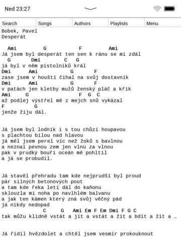
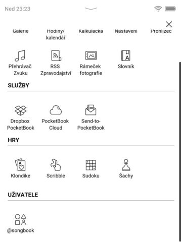
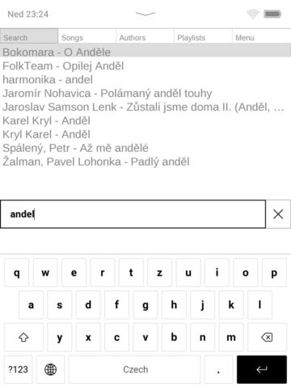
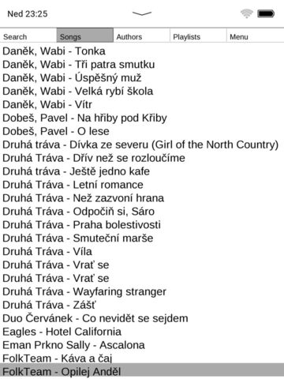
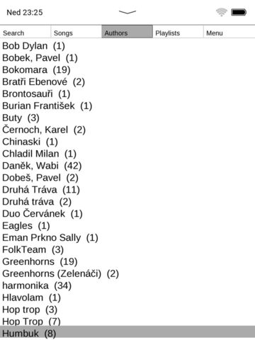
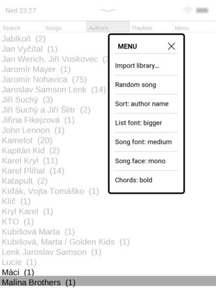

# PocketBook Songbook

Offline songbook for the **PocketBook InkPad 3 Pro (PB740)**. It reads libraries exported from the Android app [Songbook (Karel Hovorka)](https://play.google.com/store/apps/details?id=eu.karelhovorka.zpevnik&hl=en) (`InetSongDb` / `.xml`).

Browse by search, song, author, or playlist; open a song with chords above the lyrics; transpose and change fonts on the device—no network required.



## Install

1. Download the latest **`songbook.zip`** from the [Releases](https://github.com/MichaelMraka/songbook/releases/latest) page.
2. Unzip it. You should get `songbook.app` (and any files included in the release).
3. Connect the PocketBook over USB. The internal storage appears as the drive root (`applications/`, `books/`, …).
4. Copy onto the PocketBook:

   ```text
   applications/songbook.app
   songbook/                  ← create this folder for your library
   ```

5. Eject safely, then open **Applications → songbook** on the reader.

To build from source instead, see [Developer docs](docs/DEVELOPMENT.md).



## Import a library

Export your songs from the Android Songbook app, then either:

- Copy the XML into `songbook/library.xml` over USB, or  
- Put the file somewhere on the device and use **Menu → Import library…** (file browser starting at the USB/flash root). Choose **Replace** or **Merge**.

Settings are stored automatically in `songbook/settings.json`.

## Browse

| Tab | What it does |
|-----|----------------|
| **Search** | Type a query. Matches **title and author** by default. Start with `#` (or `@*~!%$.:/?`) to search **lyrics**. |
| **Songs** | Full library list (sort order from Menu). |
| **Authors** | Authors with song counts; open one to see their songs. |
| **Playlists** | Playlists from the imported library. |
| **Menu** | Import, random song, sort, fonts, chord style. |









## Song view

- Chords are shown above the lyrics.
- **Left / Right** — transpose down / up.  
- **Minus / Plus** — smaller / larger song font (can be saved per song from the song menu).  
- **Menu** (hardware) — opens search.  
- On-screen **Menu** tab while viewing a song — song actions (transpose save, edit, fonts).

## Edit a song

From the song menu: **Edit song…**

- **Author** / **Title** — on-screen keyboard (current value is prefilled; cancel keeps the old text).
- **Edit song text** — line list: tap a line to edit it, insert/delete lines, **Done** to save. Shown in a monospace font so spaced chord lines stay aligned.

## Controls (summary)

| Action | How |
|--------|-----|
| Switch tab | Top tabs, or Left/Right on list screens |
| Move / page | Up/Down; Prev/Next page lists |
| Open | OK or tap |
| Back | Back key |
| Search | Search tab, or hardware Menu key |
| Import | Menu → Import library… |

## For developers

Build, tests, architecture, and device paths: **[docs/DEVELOPMENT.md](docs/DEVELOPMENT.md)**.
